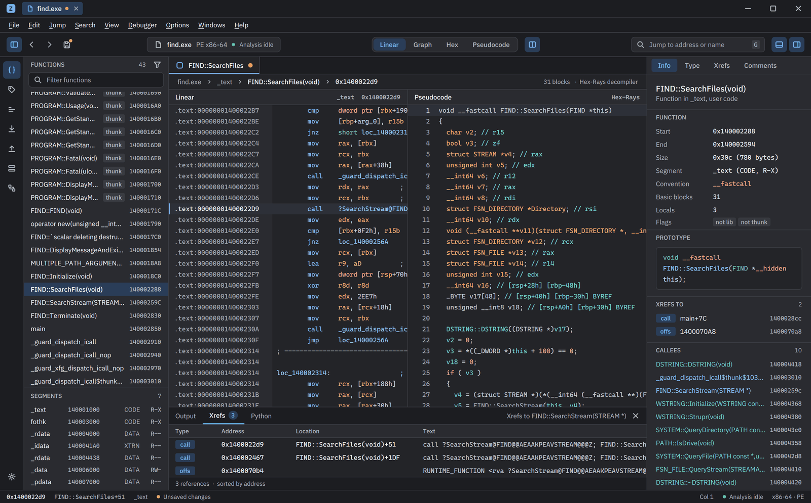
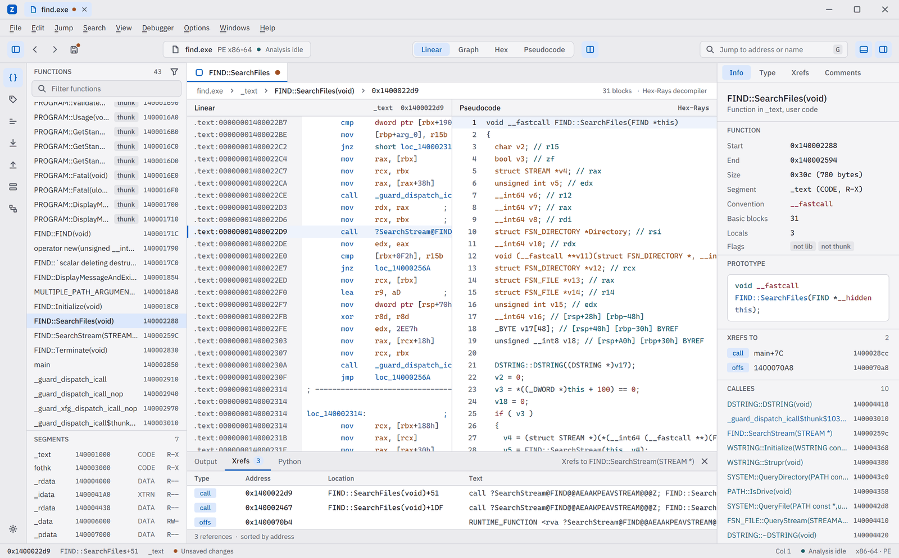
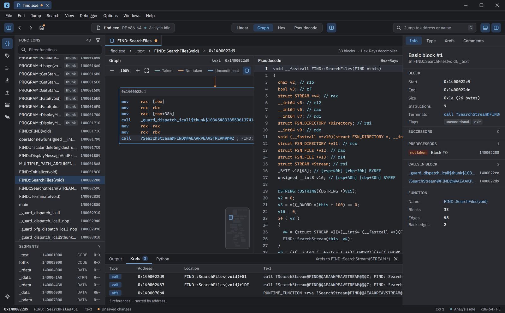
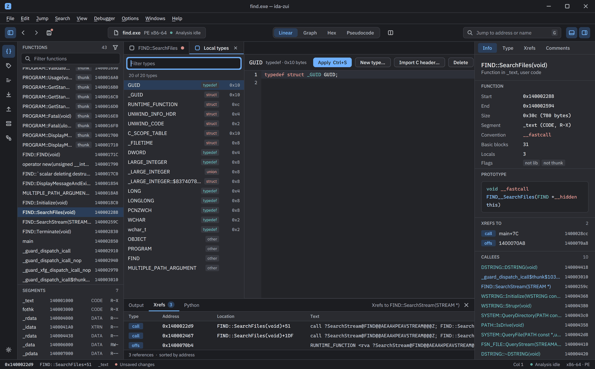
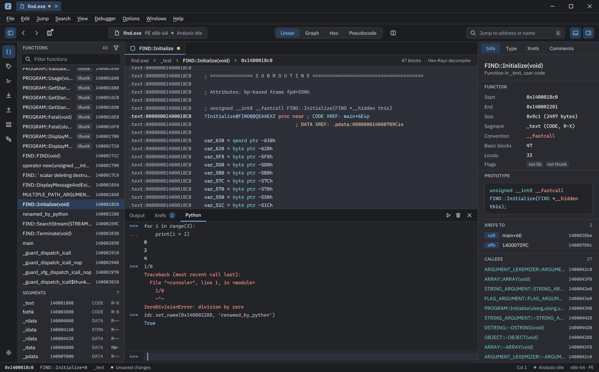
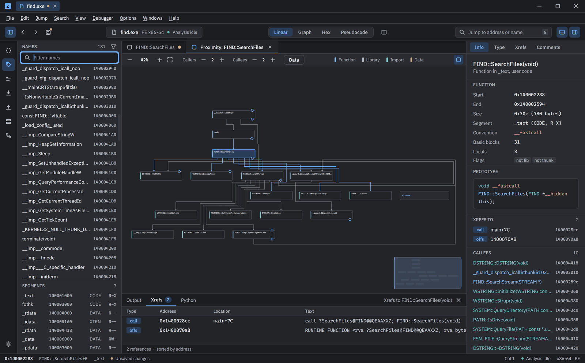
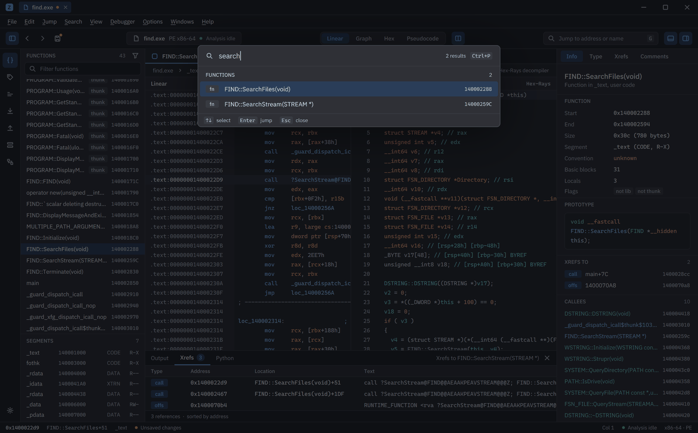

# ida-zui

**A modern, GPU-rendered front end for IDA Pro, written in Rust.** The IDA kernel runs headless through idalib in its own process; the UI is built on [zui](https://github.com/zeronsh/zui), a fork of Zed's gpui. No Qt anywhere.





> **Status: early.** Disassembly, pseudocode, graph, hex, type editors, a Python console, signatures, plugins and multi-database windows work today. Local Windows debugging works too. See [Status and known gaps](#status-and-known-gaps) and [docs/GAPS.md](docs/GAPS.md).

## Features

- **Linear listing, graph, hex and Hex-Rays pseudocode**, with a split view (listing or graph beside pseudocode) and cursor sync. Disassembly comes from IDA's own line generator, so colours, comments and xref annotations match IDA.
- **Graph view** with a layered layout, routed edges (taken, not taken, back edges), zoom, pan and a minimap.

  

- **Type editors**: a Local types editor with a C declaration editor (highlighting, parser errors on the line), structure/union and enum tables, and the stack frame of a function.

  

- **IDAPython console** in the bottom panel: multi-line input, history, coloured output and tracebacks, Cancel for a running script, and `File > Script file...`.

  

- **Proximity browser**: the call neighbourhood of a function, callers above and callees below, with a minimap.

  

- **Command palette and jump-anywhere**: every command is searchable, and `G` jumps to an address, name or expression.

  

- **FLIRT signatures**, **Lumina** pull and (confirmed) push, and **plugins**: IDA's plugin loader entries are listed, can be run headless, and get keymap entries.
- **Debugger** (Windows, user mode): start or attach, breakpoints (conditional, hardware), step into / over / out, run to cursor, registers (editable, changes highlighted), stack, memory, call stack, threads, modules, exceptions and the program's debug output, with markers in the listing, graph, pseudocode and hex view. Details below.
- **Several databases per window**, one host process each, with analysis progress, safe close (Save / Don't save / Cancel) and recent files.
- **Settings**: themes (Dark, Light, High contrast, IDA Classic), fonts, an editable keymap with conflict detection, and analysis and Python options.

## Requirements

- Windows 10 or 11 (x64).
- **IDA Pro 9.x with idalib** and a valid licence. The Hex-Rays decompiler is needed for pseudocode. ida-zui looks for the newest `IDA Professional *`, `IDA Pro *` or `IDA *` folder under `%ProgramFiles%` that contains `idalib.dll`, or uses `IDADIR`.
- The **IDA SDK** matching your IDA, to build the host. Extract it to `third_party/idasdk*/` (for example `third_party/idasdk/`) or point `IDASDKDIR` at it. It is licensed by Hex-Rays and git-ignored: never commit it.
- Rust 1.98 or newer (edition 2024) and the MSVC toolchain (Visual Studio 2022 Build Tools with the C++ workload).

## Quick start

```powershell
git clone https://github.com/heyimada/ida-zui.git
cd ida-zui
# Extract the IDA SDK into third_party\idasdk (or set $env:IDASDKDIR)
cargo build --workspace --bins          # builds ida-zui.exe and ida-host.exe
.\target\debug\ida-zui.exe C:\path\to\binary.exe [--goto main]
```

`ida-zui.exe` looks for `ida-host.exe` next to itself. Opening a binary creates or reuses `<binary>.i64` beside it, as IDA does. Drag and drop, `File > Open` and `ida-zui a.exe b.dll` all work. Use `--release` for an optimised build.

Without the SDK you can still build and test the UI side: `cargo build -p ida-zui` and `cargo test -p ida-proto -p zui-editor -p ida-zui`. That is what CI does.

## Architecture

```
┌──────────────────────────┐   JSON lines over stdio   ┌──────────────────────────────┐
│ ida-zui.exe (crates/app) │ ───────────────────────▶  │ ida-host.exe (crates/ida-host)│
│  zui UI, forbid(unsafe)  │ ◀─────────────────────── │  Rust loop + C++ shim (SDK)   │
│  depends on ida-proto    │   stderr = IDA's output   │  links ida.dll / idalib.dll   │
└──────────────────────────┘                           └──────────────────────────────┘
```

- **`crates/ida-proto`** holds the typed request/reply protocol, the `Client`,
  and the parser for IDA's colour-tagged lines (`tags.rs`). It is pure Rust
  with no IDA dependency, and it is the only crate the UI links.
- **`crates/ida-host`** owns idalib. idalib is single-threaded, so every call
  runs on the host's main thread. `shim/shim.cpp` is a thin `extern "C"` layer
  over the SDK that returns JSON. IDA's own stdout is redirected to stderr, and
  the UI shows it in the output panel. Besides replies, the host writes
  unsolicited `{"event": ...}` lines: `log` (IDA's messages, captured with a
  `ui_msg` hook), `db_changed` (IDB hooks, coalesced to at most ~8 per second,
  tagged `request` or `python` by origin) and `analysis` (stage, percent,
  functions found). `ida_proto::Client::spawn_with_events` routes them to a
  channel per host.
- **`crates/app`** is the UI.

The host runs in its own process for three reasons:

1. `ida.dll` exports data symbols (`callui`), so it can't be delay-loaded.
2. An IDA fatal error then can't take the UI down with it.
3. idalib allows one database per process.

The host exits when its stdin closes or when the UI process dies.

## Window layout

Top to bottom: title strip (the product glyph, then one chip per open database), menu bar, a 44 px toolbar, the body and a status bar. The toolbar has the sidebar toggle, back, forward and save (a dot marks unsaved changes), the file pill, a **Linear | Graph | Hex | Pseudocode** control, a split toggle (listing or graph beside pseudocode), the jump field and the bottom-panel and inspector toggles. The body is an activity rail (Functions, Names, Strings, Imports, Exports, Segments, Types), the list, the editor column and the inspector.

- **Editor column:** a tab strip (the main view, then Local types, structures, enums and frames), a jump bar (`file > segment > function > address`), the centre view (or two panes when split) and the bottom panel.
- **Inspector:** Info (function facts, prototype, xrefs, callees; in graph view the basic block, its successors, predecessors and calls), Type, Xrefs and Comments.
- **Bottom panel:** Output, live Xrefs to the name under the caret (click a row to jump) and a Python tab with the IDAPython console (below).
- Panels toggle from the toolbar and the View menu (`Ctrl+Alt+I` inspector, `Ctrl+Alt+J` bottom panel) and drag to resize; sizes, visibility and the split are remembered in `settings.json`.
- The graph has a header strip (zoom controls, edge legend, minimap toggle) and a bottom-right minimap (click to pan; `View > Graph minimap`). Blocks drop the indent their instructions share. The palette groups results with kind badges and highlights the matched text. The themes are Dark and Light (plus High contrast and IDA Classic); IBM Plex Sans is bundled.

## Debugger

`Debugger` menu, toolbar controls while a process exists, and panels in the bottom dock (`Debugger > Debugger windows`): Registers, Stack, Memory, Call stack, Threads, Modules, Breakpoints, Events and Exceptions. It drives IDA's own `win32` debugger module through the host, so conditions, hardware breakpoints and the exception table are IDA's.

- **Start / attach:** `F9` starts the database's input file (or the program, arguments and folder from `Settings > Debugger`) and continues a suspended process. `Debugger > Attach to process` lists running processes. Stopping at the entry point, on library or thread events and disabling ASLR are options; the exception policy (IDA defaults, pass all, stop on all) is applied at start and the Exceptions panel sets single codes.
- **Breakpoints:** `F2` or a click in the marker gutter (listing, graph, pseudocode) sets one; a filled red dot is enabled, an outline is disabled. The Breakpoints panel enables, removes, shows hit counts (this session) and edits the condition (double-click; an IDC expression such as `RCX == 3`, or `py: ida_dbg.get_reg_val('RCX') == 3` for Python). They are stored in the database.
- **Stops:** the instruction pointer shows as an arrow and a highlighted line in the listing, graph, pseudocode and hex view, and the views follow it. The status bar says what happened (breakpoint, step, exception). Registers that changed since the last stop are highlighted; click a value to edit it (an expression is accepted), click a flag to toggle it.
- **Rebasing:** the system loads the program at an address of its own choosing, so the database is rebased to it while the process lives and rebased back when it ends. Saving (or closing with save) during a session ends the session first, and a rebased database is never written. Every address the UI holds (history, cursor, lists) follows the move.
- **Safety:** the debugger runs real code. Debug only programs you trust. The tests debug a small program compiled from `scripts/debuggee/debuggee.c`; symbol servers are never contacted (`DOPT_LOAD_DINFO` stays off).

## Plugins and scrollbars

- **Plugins** (`Edit > Plugins`, `Windows > Plugins`, palette "Run plugin: <name>"): the host lists IDA's plugin loader entries (name, hotkey, flags, path, loaded state, from IDADIR and every IDAUSR plugins folder) and runs one by path with an argument (`plugin_list`, `plugin_run`). Each runnable plugin is a keymap command in the "Plugins" category with its own hotkey as default (editable under Settings > Keyboard). The Plugins window filters, shows hidden entries, runs the selection and opens the plugins folder. A plugin that needs IDA's Qt UI is reported as unable to run headless with its log, never hangs. Tests never run your own plugins.
- **Scrollbars**: an overlay bar (`scrollbar.rs`) on listing, pseudocode, hex, side lists, palette and modal lists, bottom panel, inspector, settings, tables, editors and both graph canvases (both axes against the graph bounds): thumb appears on hover, scroll and drag; track click pages; thumb drag scrolls.

## Signatures, Lumina and the proximity browser

- **Signatures** (`Windows > Signatures`, `Shift+F5`, palette): a document tab with the FLIRT signatures in the database's list (name, description, state, modules matched) and the `.sig` files available for its processor, with their description and function count. Click rows to pick files (applied ones are greyed), filter by name or description, press **Apply**. The analysis queues run again with progress in the status bar, the lists refresh and library functions get the `lib` badge.
- **Lumina** (`File > Lumina`, palette): pull metadata for all functions or the current one, and push (with a confirmation). IDA has no SDK API for Lumina, so the actions are the kernel's own (`LuminaPullAllMds`, `LuminaPullMd`, ...) and their outcome is read from IDA's log and the number of functions that carry Lumina metadata; an unreachable server shows a dialog with IDA's message. **A push uploads your analysis to a third-party server.** The UI asks first, naming the server and what is uploaded, with Cancel as the default answer; the host refuses a push without the confirmation flag, and always when `IDA_ZUI_AUTOMATION` or `IZS_BLOCK_LUMINA_PUSH` is set (the E2E and capture scripts never push). The server comes from IDA's own setting and is never changed.
- **Proximity browser** (`Windows > Proximity browser`, palette): the call neighbourhood of the function at the cursor as a document tab "Proximity: <name>", callers above and callees below (2 levels each; steppers in the header), at most 12 neighbours per node and 150 nodes. Labels use the code font at its normal size and scale with the zoom; the view fits on open; a level wraps into rows of 4 and folds past 8 nodes into a "+N more" chip (click it to open the level). A node shows its address and call counts and a + / - button when it has more callers or callees than shown. Click a node to recentre on it, double-click to jump to it in the listing; drag to pan, `Ctrl+wheel` to zoom, minimap as in the graph.

## Python console and scripts

The bottom panel's **Python** tab (`View > Python console`) is an IDAPython REPL running in the database's host. The input is the multi-line code editor with the Python highlighter: **Enter** runs the statement once it is complete (Python's own `codeop` decides, so an open block or bracket continues on the next line and a block ends with a blank line, as in IDA's console), **Shift+Enter** adds a line, **Ctrl+Enter** runs whatever is there, **Up / Down** on the first / last line walk the history (the half-typed text comes back). Statements run in `__main__`, the value of a trailing expression is printed, and `idc.here()` / `ida_kernwin.get_screen_ea()` are the address under the UI cursor. Output is coloured by stream (stdout, stderr, expression values, tracebacks, which show the source line). History (500 entries, adjustable in Settings > Python) is kept in `python_history.json` next to `settings.json`.

While a script runs the host cannot answer other requests, so the console shows a *Running* strip with elapsed time and **Cancel**, which raises `KeyboardInterrupt` in the script (a script stuck in a long C call or `time.sleep` stops when that call returns). A script's changes reach the views through `db_changed` events once it returns; edits made from Python show in the listing, lists and inspector without a manual refresh. One undo reverts a whole script run. `File > Script file...` (`Alt+F7`) runs a `.py` file. IDC is not exposed.

## Analysis progress

Opening a binary steps the auto-analysis queues instead of waiting in one call. The loading screen shows a progress bar with the queue's stage, a percentage (an estimate from the stage and the address, never going backwards), functions found so far and elapsed time; the database chip and the status bar show the percentage too, and edits that re-run the queues (make code, create function) report the same way. Turn it off, or analysis on open, in Settings > Analysis. Timing against IDA's own loop is in `docs/PLAN.md`.

## Several databases

Every open database is a chip in the title strip: file name, a spinner and elapsed time while it analyses, an unsaved dot and a close button. Each has its own host process, session, views, editor tabs, history and panel selections; the menu bar, settings, keymap and panel sizes are shared. Opening a file (File > Open, drag and drop, recent files, `ida-zui a.exe b.dll`) adds a chip, and opening one that is already open switches to it. `Ctrl+Tab` / `Ctrl+Shift+Tab` and `Ctrl+1..9` switch, `Ctrl+W` / the chip's X close one (asking Save / Don't save / Cancel for that database), and the Windows menu lists them. Closing the window asks once for all unsaved databases, then closes every host. Tabs in the background neither repaint the window nor poll.

## Menus, settings and keys

The window has a menu bar (File, Edit, Jump, Search, View, Options, Windows,
Help; the Debugger menu is described under Debugger). Click a title, hover to
switch menus, use the arrow keys and Enter, press `Alt` or `F10` to focus the
bar, or `Alt+F/E/J/S/V/O/W/H` to open a menu. Shortcuts shown in the menus come
from the live keymap. Every command is also in the command palette.

`Options > Settings...` (`Ctrl+,`) holds the theme (Dark, Light, High contrast,
IDA Classic), the code font and size, the UI font size and the keyboard
shortcut editor (click a command, press the new keys; conflicts are flagged).
Settings live in `%APPDATA%\ida-zui\settings.json`; a missing or damaged file
means defaults. `File > Open with options...` (`Ctrl+Shift+O`) opens a raw file
with the Binary loader, a processor (x86, ARM/AArch64, MIPS, PowerPC, 68k, 8051,
AVR, RISC-V, SH4, Z80, WebAssembly), a base address and optional auto-analysis;
the dialog says where the copy and the database will be written. Recent files
show on the welcome screen and in `File > Recent files`. `Help > About` shows the
IDA and SDK versions and paths.

## Keyboard shortcuts

IDA's defaults are used where IDA has one.

| Key | Action |
|---|---|
| `G` / `Ctrl+P` | Jump to an address, name or expression (fuzzy over functions and names) |
| `Esc` / `Alt+←`, `Ctrl+Enter` / `Alt+→` | Back, forward |
| `Enter`, double-click | Follow the name under the caret, or expand a collapsed item |
| `Space` | Toggle between linear and graph view |
| `Tab` / `F5` | Open pseudocode, or switch focus between the panes |
| `Ctrl+Shift+H` / `Ctrl+Shift+D` | Hex view / disassembly |
| `N` | Rename (a local variable in pseudocode) |
| `;` / `:` | Comment / repeatable comment |
| `Y` | Set the type (a function prototype, or a local variable's type in pseudocode) |
| `X` / `Shift+X` | Cross references to / from |
| `C` `D` `A` `U` `P` | Make code, cycle data size, make string, undefine, create function |
| `Shift+Del` | Delete function |
| `-` | Expand or collapse a function or hidden range |
| `Alt+B` / `Alt+T` | Search bytes (`48 8B ?? 24`) / search text, downward from the cursor |
| `Ctrl+S`, `Ctrl+Z`, `Ctrl+Y` | Save, undo, redo |
| `Ctrl+B` | Filter the side panel |
| `Shift+F1` / `Shift+F9` / `Shift+F10` | Local types editor / pick a structure / pick an enum |
| `Ctrl+K` | Stack frame of the function at the cursor |
| `Ctrl+F4` | Close the editor tab |
| In the structure, enum and frame tables: `N` `Y` `;` `D` `U`/`Del` `X` `Ins` | Rename, retype (value for enums), comment, cycle size / define, delete, xrefs, add |
| In the type editor: `Ctrl+S` / `Ctrl+Enter` | Apply the declaration |
| `` Ctrl+` `` | Output panel (IDA's messages) |
| `Alt+F7` | Run a Python script file |
| In the Python console: `Enter` / `Shift+Enter` / `Ctrl+Enter` / `Up`, `Down` | Run if complete / new line / run anyway / history |
| `Ctrl+Alt+J` / `Ctrl+Alt+I` | Show or hide the bottom panel / the inspector |
| `F9` / `F12` / `Ctrl+F2` | Debugger: start or continue / pause / terminate |
| `F7` / `F8` / `Ctrl+F7` / `F4` | Debugger: step into / step over / run until return / run to cursor |
| `F2` / `Ctrl+Alt+B` | Debugger: toggle a breakpoint at the cursor / breakpoint list |
| `Ctrl+Shift+P` | Command palette (every command, searchable) |
| `Ctrl+=` / `Ctrl+-` / `Ctrl+0` | Graph zoom (`Ctrl+wheel` also zooms; drag to pan) |

## Testing

- **Unit tests** (`cargo test --workspace`) cover pure logic: the colour-tag parser, the graph layout invariants, the declaration-error mapper, the editor's text model and scrollbar geometry.
- **Protocol E2E** (`.\scripts\e2e.ps1 [-Sample <exe>]`) builds everything, opens a fresh copy of the sample (default `C:\Windows\System32\find.exe`) through `ida-host.exe` and exercises every request plus edit, undo/redo, save and reopen. It writes a deterministic dump to `artifacts/e2e/<name>.txt` and IDA's log next to it, and exits non-zero if any check fails. It needs your IDA and SDK.
- **UI automation** (`.\scripts\ui-capture.ps1 -Goto <expr> -Steps "wait:15000","shot:x","key:tab","action:ida::OpenSettings",...`) drives the real app through its in-app automation channel (`IDA_ZUI_AUTOMATION`): no OS input is synthesised and only the app window is captured, so it never touches your other windows or clipboard. Steps: `key:`, `type:`, `action:`, `click:x,y`, `confirm:n`, `marker:`, `shot:`, `close`, `waitexit:ms`, `files:glob`; switches `-NoFile`, `-Reuse`, `-Settings '<json>'`, `-Release`, `-Log name`. Screenshots go to `artifacts/ui/*.png`. The screenshots in this README were made this way on `find.exe`.

Tests never push to Lumina: the host refuses a push whenever `IDA_ZUI_AUTOMATION` or `IZS_BLOCK_LUMINA_PUSH` is set.

## Status and known gaps

**Works**
- Linear disassembly with IDA's own line generator: colours, comments, xref
  annotations. It pages in both directions and expands collapsed items.
- Hex-Rays pseudocode with anchor-based navigation, local-variable rename and
  retype, and cursor sync with the listing.
- Graph view with a layered layout, taken / not-taken / back edges, zoom and pan.
- Hex view over segments.
- Side lists for functions, names, strings, imports, exports, segments and
  local types, all filterable. Double-clicking a type opens its editor.
- Type editors, in tabs next to Disassembly / Graph / Hex (View and Windows
  menus, palette, Types side tab): a **Local types** editor with a list and a
  C declaration editor (highlighting, parser errors as markers on the line, new
  type, delete with dependents, header import by paste); a **structure / union**
  table with inline editing, add / delete / retype, member xrefs and a C
  declaration mode; an **enum** table (hex / decimal, bit flags); and the
  **stack frame** of a function (locals, saved registers, return address,
  arguments, undefined gaps you can define). Edits are undoable and show in the
  listing and pseudocode.
- Jump-anywhere, xrefs, command palette.
- Rename, comments, types, code/data/string/function editing, undo/redo, save.
- Closing is safe: every way of closing the window (Alt+F4, the title-bar X,
  Ctrl+Q) asks Save / Don't save / Cancel when there are unsaved changes, then
  closes the database through the host, which packs it into the `.i64`. A
  database that was freshly analyzed counts as unsaved. Closing one database tab asks the same question for that database only. A host that does not
  answer within 15 s is killed.
- Large databases work: `shell32.dll` (34k functions, 55k names) opens and pages
  through the listing in both directions; the 32-bit `find.exe` works too.

**Partial**
- **Type editors:** parser errors are mapped to lines by searching for the
  token IDA names, since `parse_decls` reports no line numbers. Struct-member
  xrefs are implemented but only an empty result was exercised (the sample has
  no struct-offset operands). IME input in the code editor is untested.
- **Text search** uses IDA's `find_text`, so it can be slow on large databases.
- **Refresh after edits:** edits made in this UI refresh through their own request; changes made by scripts refresh through `db_changed` events once the script returns (not while it runs, since the host is busy). Plugins that change the database outside a request would be reported with origin `request` and are not refreshed.
- **Python console:** no completion or inline help; IDC is not exposed; Cancel needs the script to be running Python bytecode (see above); output is delivered when a command returns, not streamed (the Output tab streams it).
- **Several databases:** the listing columns are stored in the .i64 when saved. Tab switching and chip clicks were driven through the automation channel, which bypasses the OS hit test, so a real mouse click on a chip (outside the drag area) is untested. Closing a tab whose analysis is still running waits up to 15 s for the host before killing it.
- **Analysis percentage** is an estimate (stage bands calibrated on shell32.dll), not IDA's own measure.
- **Graph edges** are routed around blocks: a long edge gets a waypoint in every layer it crosses and runs in the gaps between layers, loops use lanes right of the graph. Two edges may still share a short stretch of line where waypoints of different layers coincide, and the crossing count is only reduced (barycentre ordering), not minimised.
- **Lumina:** pull and push are wired to the kernel's own actions and read their outcome from IDA's log. Only the error path (an unreachable server) has been exercised; a successful pull against a live server has not been verified. Push is never executed by any test (see above).
- **Proximity:** clicking the + / - buttons and double-click navigation are implemented and E2E-covered only through the host method; the clicks themselves were not driven in the UI. Data nodes (the Data toggle) are implemented but only default off was checked.
- **Signatures:** applying runs the whole analysis queue again, as IDA does; the window lists `.sig` files of the processor's `sig` directories in `IDADIR` and `IDAUSR` and reads their title and function count from the file header. Un-applying a signature is not offered (IDA cannot remove one from a database either).

**Restyle gaps**
- Scrollbars cover every scrollable surface except the single-line Python input and menu bar dropdowns that fit. The editor's scrollbar path (`editor_source`) was checked only through the same code as the other surfaces: no screenshot of an editor with overflowing text was taken. The listing's thumb reflects the loaded buffer, not the whole address space.
- Graph edges: loops and long edges into one block share one trunk and one arrival port. Edges sharing only a source are not bundled. The graph view still stops zooming out at 15% (L7).
- The graph does not fold "N earlier instructions", and the focus ring is a 2 px spread without the 1 px offset.
- Recent files show size and age but not the architecture badge.
- Settings: the About section is listed but disabled.
- The split is off by default (the design's main window shows it on).
- High contrast and IDA Classic extend the token set but have no mockup to compare against.

**Debugger gaps**
- Windows user mode only (the `win32` module); no remote, Linux or kernel debugging, no source-level debugging, no tracing, no appcall.
- The listing and hex view show the database's bytes, not the process memory (the Memory panel reads the process; breakpoint bytes read as the originals). The database is not synchronised with the process, so self-modifying or unpacked code shows as analysed.
- First or last chance of an exception is not reported by IDA's API; it is inferred (the same exception at the same address right after a continue is the last chance).
- Hit counts are the UI session's own count of stops; threads show no per-thread instruction pointer; xmm/ymm registers are fetched but not shown; the pseudocode marks follow the nearest statement address, not an exact instruction.
- Pausing uses a request that a target may never honour; the UI then offers to terminate (`pause_timeout`).
- Attach and detach were tested against a process we start ourselves.

**Not implemented**
- Source-level and remote debugging

The full list of known gaps, with priorities and suggested fixes, is in [docs/GAPS.md](docs/GAPS.md). The roadmap is [docs/PLAN.md](docs/PLAN.md), and technical notes on idalib are in [docs/IDALIB_FINDINGS.md](docs/IDALIB_FINDINGS.md).

## Contributing

See [CONTRIBUTING.md](CONTRIBUTING.md) and [AGENTS.md](AGENTS.md) (the contributor and coding-agent guide). Third-party components are listed in [THIRD_PARTY.md](THIRD_PARTY.md).

## License

ida-zui is released under the [MIT License](LICENSE).

**Disclaimer.** ida-zui is not affiliated with, endorsed by or sponsored by Hex-Rays. IDA and IDA Pro are trademarks of Hex-Rays SA. This repository contains no IDA binaries, databases or SDK files: you need your own IDA licence and SDK.
